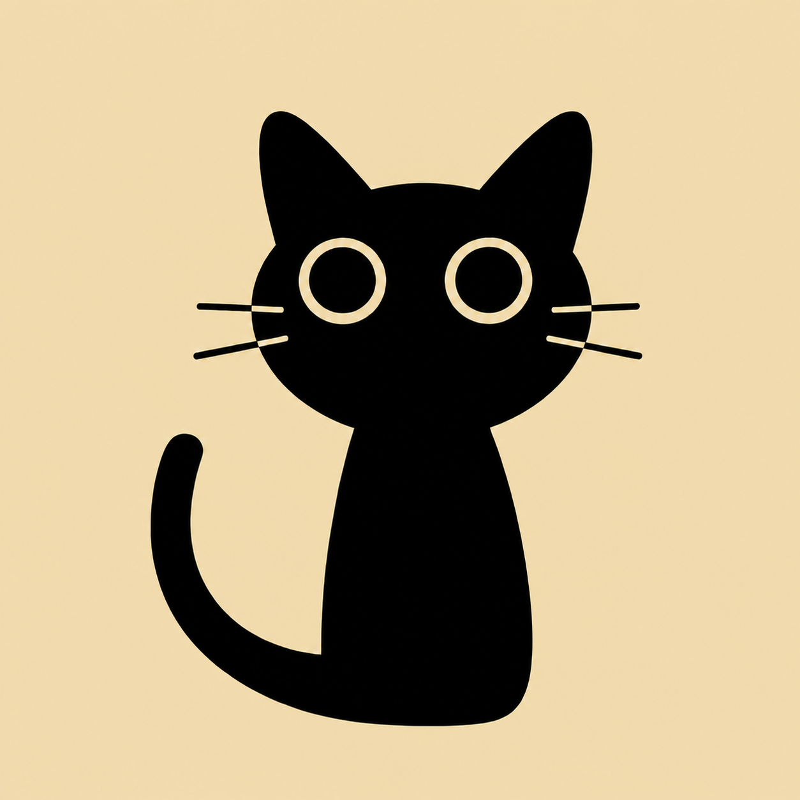

# TaskPet

<p align="center">
  
</p>

<p align="center">
  <strong>让一只常驻桌面的动画宠物，陪你把任务真正做完。</strong>
</p>

<p align="center">
  本地优先 · Windows 桌面端 · 无账号 · 无云同步 · 不记录无关进程历史
</p>

<p align="center">
 <strong>AI Vibe Coding </strong>
</p>


## 项目简介

TaskPet 是一个本地运行的桌面任务助手。你可以创建任务，并把自己选择的 Windows 程序绑定到任务上；当目标程序运行时，TaskPet 自动开始累计实际使用时间，程序退出后暂停累计，达到目标时长后自动完成任务。

<strong>使用说明</strong>：左键打开/关闭任务面板，右键打开/关闭轮盘菜单；轮盘菜单中的设置项可打开设置窗口。左键、双击和右键动作均可在设置中重新绑定。

<strong>本人体验</strong>：我感觉还不错，打游戏时可以计时，只要你不动桌宠就会置顶在游戏页面上，还能一键启动游戏，差不多相当于一个任务管理和时间统计工具，多任务时，隔3s会切换显示，桌宠大小设置看情况再修改了，目前感觉良好

## 核心功能

- 每日任务和一次性任务
- 手动完成、目标时长完成、启动即完成
- 按 exe 精确路径或进程名绑定程序
- 自动开始、暂停、续接任务累计时间
- 可按任务开启“完成任务后继续计时”，完成状态与实际使用时长独立保存
- 任务右键菜单、二次确认永久删除、已归档任务查看与恢复
- 今日任务、最近 30 天历史、今日/本周总计时
- 透明无边框桌宠、单击/双击/右键交互、拖拽、置顶、召回与三档大小
- 鼠标左键、双击、右键动作绑定
- 独立轮盘快捷菜单：任务面板、快速添加、设置、监控、桌宠、置顶、透明度/大小调节、音乐、自定义应用和退出
- 轮盘大小支持 50–130（默认 90），名称统一显示在图标下方，不显示顺序数字或关闭按钮
- 音乐与应用入口一样可编辑 EXE/LNK；单击直接启动，悬停或右键展开上一首、播放/暂停、下一首
- 五套界面主题、跟随 Windows 浅色/深色外观，多窗口即时同步
- 全局键盘映射与按键气泡提示，只监听用户主动添加的按键，不保存按键历史
- 系统托盘提供显示/隐藏桌宠、快速添加任务、设置、宠物、召回、忽略鼠标事件和退出
- 独立设置窗口、数据目录、SQLite 备份和第三方许可证入口
- PetDex 兼容桌宠 ZIP 拖拽导入、文件选择和文件夹导入

## V1.1 交互更新

- 轮盘菜单通过桌宠右键打开/关闭，轮盘中心保持透明，桌宠仍可单击、双击、拖拽和右键操作。
- 轮盘靠近屏幕边缘时会自动调整位置，透明度与大小调节滑块固定在轮盘下方。
- 轮盘可通过 Esc 或点击外部关闭，不设置额外的关闭按钮；普通左键单击不会被误判为拖动。
- 开启“忽略鼠标事件”后只忽略普通左键单击，双击、拖动和右键操作仍然有效。

## v1.2 更新

- 添加或编辑任务时，先绑定程序，再开启“完成任务后继续计时”。目标时长、手动完成和启动即完成都支持；默认关闭以兼容旧任务。开启后，任务保持“已完成”，仍可继续累计，程序退出后暂停，再运行时续接。需要停用时可关闭此选项或归档任务。
- 右键任务卡片或点击卡片右侧“⋯”，可以编辑、完成/重新打开、归档、永久删除。也支持 `Shift + F10`、方向键和 `Esc`。
- 任务页右上角“已归档”可查看和恢复任务。归档保留历史与计时；永久删除会移除任务、程序绑定、全部实例和会话，影响统计，操作前有二次确认。
- 历史日期旁显示当日累计 `HhMminSs`，包括当天未完成任务和已归档任务的实际会话。当天只有计时、没有完成任务时也会显示日期。统计与今日/本周计时采用相同的会话区间口径。
- 设置 → 轮盘菜单 → 菜单项，在“音乐”一行点击“编辑”，可像应用入口一样选择本地 `.exe` 或 `.lnk`、修改名称并测试启动。左键直接打开播放器，不等待媒体会话；悬停或右键提供上一首、播放/暂停、下一首。媒体控制需要播放器支持 Windows 系统媒体控制，不能识别会话时不会控制其他播放器；未绑定时保留旧 QQ 音乐三按钮兼容功能。
- 设置 → 外观与主题，提供经典暖杏、深夜墨蓝、奶油白、森林青绿、樱花粉，以及跟随 Windows 外观。主题只改变界面，不修改桌宠素材。

## 展示
<p>  <strong>任务面板 </strong></p>


<p>  <strong>轮盘界面 </strong></p>


<p>  <strong>设置 </strong></p>


## 工作原理

TaskPet 不会持续记录“用户打开过哪些软件”。它只对用户主动绑定的程序做低频即时匹配：

```text
创建任务并绑定目标 exe
        ↓
目标程序出现：任务 pending → active
        ↓
按真实经过时间累计，不按 PID 数量重复计算
        ↓
目标程序退出：经过约 4 秒确认后暂停
        ↓
下次启动同一程序：从已有累计时间继续
        ↓
累计达到目标：任务只完成一次，桌宠播放完成状态
```

任务、任务实例和程序会话分别保存。每日任务会为新的一天生成新的 `TaskOccurrence`，不会通过清空昨天的完成状态来“重置”。

## 软件界面

| 界面 | 用途 |
| --- | --- |
| 桌宠 | 常驻桌面、显示任务状态、单击/双击/右键动作与拖拽 |
| 任务面板 | 今日任务、历史记录、总计时、添加/编辑任务和程序绑定 |
| 轮盘菜单 | 快速打开任务、设置、监控、桌宠、音乐、透明度/大小和自定义应用 |
| 设置 | 桌宠、鼠标绑定、键盘映射气泡、轮盘菜单、数据与关于 |
| 系统托盘 | 显示/隐藏、快速添加、设置、宠物、召回、忽略鼠标事件与退出 |

设置窗口和任务面板是彼此独立的窗口；关闭设置不会关闭桌宠或任务监控。

## 技术栈

- Electron 28
- TypeScript 5
- SQLite / `better-sqlite3`
- Win32 进程读取 / `koffi`
- Zod IPC 参数校验
- electron-builder / NSIS
- Node.js 原生 test runner

## 项目架构

```text
Electron Main Process
├── 桌宠窗口、轮盘菜单、按键气泡、Tray、设置和应用生命周期
├── TaskSystem（任务子系统协调器）
│   ├── TaskService / Repository / SQLite
│   ├── ProcessProvider → ProcessMatcher → ProcessMonitor
│   ├── RuntimeTracker → TaskEventBus → PetStateMachine
│   └── DataService / LoginItemService
└── 安全 Preload
    ├── 桌宠 Preload → 桌宠 Renderer
    ├── 面板 Preload → 任务面板 Renderer
    ├── 设置 Preload → 设置 Renderer
    ├── 径向菜单 Preload → 径向菜单 Renderer
    └── 按键气泡 Preload → 按键气泡 Renderer
```

所有文件系统、SQLite、系统进程和窗口能力都留在 Main Process。Renderer 保持 `contextIsolation: true`、`nodeIntegration: false`，任务面板和设置窗口还启用了 sandbox；页面只能调用 Preload 暴露的固定 IPC。

## 轮盘菜单与键盘映射

轮盘菜单是独立的透明窗口，默认通过桌宠右键打开/关闭。内置项目可以在设置中启用、停用和排序，也可以添加程序（`.exe`）或快捷方式（`.lnk`）作为自定义入口。轮盘大小范围为 50–130，默认值为 90；轮盘标签贴在图标下方，不显示顺序数字。

轮盘提供任务面板、快速添加、设置、监控、桌宠、忽略鼠标事件、置顶、桌宠透明度/大小、轮盘透明度/大小、音乐和退出等操作。音乐主入口与应用一样直接启动目标；悬停约 250ms 或右键展开原有三按钮。轮盘中心不会遮挡桌宠，打开调节项时滑块固定在轮盘下方。

键盘映射可为用户主动添加的按键设置显示标签。按键触发时只在桌宠上方短暂显示对应气泡，不记录键盘历史，也不会监听未添加的按键。

## 任务类型

| 类型 | 行为 |
| --- | --- |
| 每日任务 | 每个本地自然日生成一个新的任务实例，历史互不覆盖 |
| 一次性任务 | 保留同一个任务实例，直到完成或归档 |

| 完成方式 | 行为 |
| --- | --- |
| 目标时长 | 绑定程序累计达到目标时长后自动完成，默认方式 |
| 手动勾选 | 由用户在今日任务中完成或重新打开 |
| 启动即完成 | 检测到绑定程序启动后立即完成；开启续计时时同时记录实际运行会话 |

“完成任务后继续计时”默认关闭。开启时，完成时间只记录首次完成的时刻，后续计时不重复完成、不重复播放完成动画。每日任务仍在午夜切换到新实例；一次性任务一直沿用原实例。归档后停止监控，恢复每日任务不补建归档期间的实例。

## 程序监控

- 只匹配任务主动绑定的程序，不保存完整系统进程快照。
- 支持精确 exe 路径和进程名匹配；精确路径更不容易误匹配。
- 多个同名 PID 只计算一份 wall-clock 时间。
- 默认约 2.5 秒扫描一次，程序消失后约 4 秒再次确认。
- 没有可监控的绑定任务或用户暂停监控时，`ProcessMonitor` 不保留扫描 timer。已完成且允许续计时的任务仍属于监控候选。
- 今日任务中的“启动”按钮只会打开用户明确选择过的 exe，不接受任意 shell 命令。

## 总计时

“总计时”统计的是 TaskPet 已实际记录的程序运行时间，不是任务目标时长。

- 今日计时：本地当天 `00:00` 至 `23:59`。
- 周计时：本地自然周周一 `00:00` 至周日 `23:59`。
- 任务按累计时长从高到低排序。
- 正在运行的会话会与已保存的 `ProcessSession` 一起统计。
- 历史按本地自然日与会话区间取交集，跨午夜分别计算；不同任务同时运行时按各自时长相加，并非电脑忙碌时间去重。

## 桌宠系统

发布包会携带 `src/assets/pets` 当前目录中的宠物资源，不会在构建时恢复已删除资源，也不会在界面中区分资源来源。TaskPet 使用六个基础状态：

```text
idle / working / done / attention / drag-left / drag-right
```

桌宠大小延续 v1.1 的 60%–180% 调节，默认 100% 的宠物视觉尺寸为 96 × 104，窗口约 120 × 143。可在设置或轮盘中调整。

## 自定义桌宠

设置 → 桌宠 → 导入宠物支持：

- 把一个 `pet.zip` 拖入导入区域
- 通过文件选择器选择 ZIP
- 选择一个已经解压的宠物文件夹

可在 [PetDex](https://petdex.dev/zh) 下载社区宠物，或使用 [Hatch Pet](https://petdex.dev/zh/create) 创建兼容图集。一个最小宠物包如下：

```text
pet.zip
├── pet.json
└── spritesheet.webp   # 也支持 PNG
```

```json
{
  "id": "example-pet",
  "displayName": "示例桌宠",
  "description": "一只示例桌宠",
  "spritesheetPath": "spritesheet.webp",
  "frame": {
    "width": 192,
    "height": 208,
    "columns": 8,
    "rows": 9
  }
}
```

ZIP 最大 50 MB。导入器会校验文件路径、清单、图集尺寸和透明背景，并只保存 `pet.json` 与它引用的 PNG/WebP 图集。

`pet.json` 的 `id` 最多 48 个字符，支持大小写英文字母、数字、连字符、下划线和汉字，例如 `TaskPet-桌宠_01`。汉字校验使用 JavaScript 原生 Unicode 正则，不需要额外字库，不会增加安装包体积。

### 用户桌宠保存位置

默认桌宠与用户导入的桌宠使用同一个目录，不再按来源分开，也不会在界面中显示来源字样。

开发仓库中的目录是：

```text
src\assets\pets\<pet-id>\
├── pet.json
└── spritesheet.webp
```

也就是仓库相对路径 `src\assets\pets`。ZIP、文件选择和文件夹导入都会写入这里。

发布版不能写入只读的 `app.asar`，因此构建会把同一目录复制到安装资源目录：

```text
<TaskPet 安装目录>\resources\src\assets\pets\<pet-id>\
```

发布版导入也写入这个目录。安装 TaskPet 时应选择当前 Windows 用户有写入权限的位置；导入失败时应用会显示错误，不会悄悄改存到用户目录或系统盘。

## 数据与隐私

Windows 默认数据目录为：

```text
%APPDATA%\TaskPet\
├── taskpet.sqlite3
├── settings.json
├── logs\
└── backups\
```

具体路径始终以设置 → 数据中显示的“打开数据目录”为准。

- 任务、任务实例、程序绑定规则、相关运行会话和应用设置保存在本机。
- 不记录键盘、鼠标行为、截图、剪贴板、窗口标题、浏览内容或无关进程历史。
- 进程快照只在内存中用于当前匹配，完成后即丢弃。
- “导出备份”使用 SQLite Online Backup，不直接复制可能仍在写入的 WAL 数据库。
- 自动更新未启用，也不存在指向上游 `desktop-pet` Release 的 updater 配置。

## 安装与使用

1. 从 Releases 下载并运行对应版本安装包，例如 `TaskPet-1.2.0-win32-x64.exe`。
2. 选择安装目录并完成安装。
3. 从桌宠、轮盘菜单或系统托盘打开任务面板。
4. 添加任务；需要自动计时时，选择并绑定目标 exe。
5. 启动目标程序，TaskPet 会自动累计任务时间。

当前 Windows 安装包未做商业代码签名，系统可能显示“未知发布者”提示。请只从你信任的 TaskPet 发布页获取安装包。

## 开发环境

- Windows 10/11 x64
- Node.js 18 或更高版本
- npm
- 用于原生模块编译的 Windows C++ 构建环境（只在本机需要重建依赖时使用）

## 本地开发

```bash
npm install
npm test
npm run start
```

常用验证命令：

```bash
npm run compile
npm run smoke
npm run smoke:features
npm run smoke:v1.2
npm run smoke:keyboard
npm run perf:smoke
npm run dev:bounds
```

`npm run smoke` 会用隔离数据目录初始化桌宠、任务面板、设置窗口、轮盘菜单、按键气泡和 SQLite，成功后自动退出。`smoke:features` 验证轮盘、透明度、音乐入口和窗口层级；`smoke:keyboard` 验证 Windows 全局键盘输入；`dev:bounds` 用于显示桌宠窗口、宠物命中区与图集帧边界。

`smoke:v1.2` 通过真实窗口、preload 和 IPC 验证续计时、菜单/确认、归档恢复/删除、历史日统计、五主题同步及 Windows 外观跟随，并将截图和颜色对比度矩阵保存到被 Git 忽略的 `dist/qa-v1.2/`。音乐单元测试包括真实 PowerShell 选择/分发逻辑的模拟会话，不代表所有真实播放器均已验证；发布前应人工检查 QQ 音乐及自己绑定的播放器。

## 构建 Windows 安装包

```bash
npm test
npm run build:win
```

构建产物位于：

```text
dist\TaskPetV1.2\TaskPet-1.2.0-win32-x64.exe
dist\TaskPetV1.2\win-unpacked\
```

`publish: null` 且构建命令使用 `--publish never`，构建过程不会自动上传 Release。

## 项目目录

```text
TaskPet/
├── src/
│   ├── main.js                  # Electron 主入口
│   ├── main/                    # 数据、服务、IPC、监控、计时和窗口
│   ├── preload/                 # 桌宠、面板、设置、轮盘与按键气泡安全桥
│   ├── renderer/                # 桌宠、任务面板、设置、轮盘与按键气泡界面
│   ├── shared/                  # 前后端共享类型与 Zod 契约
│   └── assets/                  # Logo 与统一宠物目录
├── test/                        # 单元与结构回归测试
├── scripts/                     # 测试、性能与桌宠包 smoke
├── electron-builder.yml         # 发布打包配置
└── package.json                 # 脚本、依赖和唯一版本来源
```

## 当前版本

<!-- AUTO-GENERATED -->
**TaskPet v1.2.0**。变更记录见 [CHANGELOG.md](CHANGELOG.md)，安装包与发布说明见 [GitHub Releases](https://github.com/qwqsu/TaskPet/releases)。
<!-- /AUTO-GENERATED -->

设置页“关于”中的版本、Windows exe 元数据和安装包文件名都来自根目录 `package.json` 的 `version`。发布新版本时修改该字段，并同步 `package-lock.json` 即可。

## License

TaskPet 代码使用 [MIT License](LICENSE)。第三方依赖声明见 [THIRD_PARTY_LICENSES.txt](THIRD_PARTY_LICENSES.txt)。

自定义或默认桌宠素材可能有各自的版权与使用条款；导入和分发前请确认你拥有相应授权。

## 致谢 / 第三方项目

- 桌宠 Shell 的早期实现参考并精简自 MIT 项目 [yangbuyiya/desktop-pet](https://github.com/yangbuyiya/desktop-pet)。
- 自定义宠物包兼容 [PetDex](https://petdex.dev/zh) / Codex 风格的 `pet.json + spritesheet` 格式。
- 感谢 Electron、SQLite、better-sqlite3、koffi、Zod 与 electron-builder 社区。
